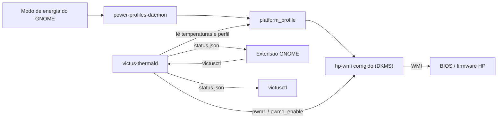

# victus-thermal

**Controle térmico no estilo OMEN Gaming Hub para o HP Victus 15-fb2xxx no Linux.**

Modos térmicos reais da HP, curvas de ventoinha por perfil, proteção de
emergência, indicador na barra do GNOME e NVIDIA só sob demanda, com
Secure Boot ligado.

| | |
|---|---|
| **Notebook** | HP Victus 15-fb2xxx, placa **8C2F** (Ryzen 5 8645HS + RTX 4050) |
| **Sistema** | Ubuntu 26.04, kernel 7.0.x, GNOME 50 (Wayland), Secure Boot ligado |
| **Versão** | 1.8.0, veja o [CHANGELOG](CHANGELOG.md) |

---

## Sumário

- [Por que existe](#por-que-existe)
- [O que você ganha](#o-que-você-ganha)
- [Instalação](#instalação)
- [Uso no dia a dia](#uso-no-dia-a-dia)
- [Como as ventoinhas se comportam](#como-as-ventoinhas-se-comportam)
- [Configuração](#configuração)
- [Segurança](#segurança)
- [Extras opcionais](#extras-opcionais)
- [Solução de problemas](#solução-de-problemas)
- [Atualizar e desinstalar](#atualizar-e-desinstalar)
- [Desenvolvimento](#desenvolvimento)
- [Licença e créditos](#licença-e-créditos)

---

## Por que existe

O driver `hp-wmi` do Linux só ativa o controle térmico da HP em placas que
estão numa lista interna, e **a 8C2F não está nela**: nem no Ubuntu, nem no
kernel oficial. Sem isso:

- os modos térmicos da HP (o que o OMEN controla no Windows) nunca são
  ativados. O "Desempenho" do GNOME só mexe na CPU;
- o firmware fica na curva de ventoinha mais conservadora. Num teste de
  carga, **a CPU chegou a 100 °C com as ventoinhas paradas por 30 s**;
- o driver NVIDIA não consegue ler da BIOS a temperatura-alvo nem o modo de
  energia (`failed to get target temp from SBIOS`).

Este projeto corrige isso na raiz e acrescenta o que o OMEN fazia.

## O que você ganha

- 🌡️ **Modos térmicos reais da HP** ligados ao modo de energia do GNOME
  (Economia, Equilibrado, Desempenho), incluindo o boost da GPU.
- 🌀 **Curva de ventoinha por perfil**, com firmware HP em carga leve, filtro de
  picos e tempo mínimo ligado. Sem o "liga-desliga" brusco.
- 🔌 **Silencioso contínuo na tomada:** as ventoinhas nunca param enquanto
  carrega.
- 🚨 **Emergência:** qualquer sensor ≥ 95 °C põe as ventoinhas no máximo, em
  qualquer modo.
- 🖥️ **Indicador na barra do GNOME:** temperatura, RPM e controles, com
  atualização instantânea.
- 🎮 **NVIDIA só sob demanda:** a RTX desliga quando ninguém usa, e os jogos
  continuam abrindo nela.
- 🔐 **Secure Boot ligado:** o driver é assinado com a sua chave (MOK) e
  recompilado sozinho a cada atualização do kernel 7.0.x.



## Instalação

> Use um **terminal normal** (Ctrl+Alt+T). O `sudo` e a criação da chave
> pedem senha, e isso não funciona pelo `!` do Claude Code.

```bash
git clone git@github.com:joaocarvalhosm/victus-thermal.git ~/Projects/victus-thermal
cd ~/Projects/victus-thermal
sudo ./install.sh all
```

**Primeira vez:** o `all` cria a chave de assinatura e **para**, pedindo uma
senha. Então:

1. Reinicie (`sudo reboot`).
2. Quando aparecer a tela azul *"Press any key to perform MOK management"*,
   **aperte uma tecla em até 10 segundos**.
3. **Enroll MOK** → **Continue** → **Yes** → digite a senha → **Reboot**.
4. Rode de novo: `sudo ./install.sh all`.
5. **Saia e entre de novo na sessão** para o GNOME carregar a extensão.

O `all` testa o driver antes de instalá-lo: ele é carregado só até o próximo
reboot, e se algo falhar o instalador **volta sozinho ao driver original**,
sem deixar nada instalado. Os passos também podem ser rodados um a um:

| Comando | O que faz |
|---|---|
| `sudo ./install.sh check` | confere placa, kernel, Python e Secure Boot |
| `sudo ./install.sh deps` | instala `dkms` e as ferramentas de build |
| `sudo ./install.sh mok` | cria a chave de assinatura e pede o cadastro |
| `sudo ./install.sh driver-test` | carrega o driver corrigido até o próximo reboot |
| `sudo ./install.sh driver-install` | instala o driver de vez (DKMS) |
| `sudo ./install.sh daemon` | instala e liga o serviço de ventoinhas |
| `sudo ./install.sh extension` | instala a extensão do GNOME para você |

## Uso no dia a dia

**O modo de energia do GNOME é o perfil.** No menu do canto superior direito,
Economia, Equilibrado e Desempenho ativam o modo térmico da HP e a curva de
ventoinha correspondente.

> **Para jogar:** carregador ligado + **Desempenho**.

### Extensão da barra

```
 🌀 61°                       ← na barra: sensor mais quente
┌──────────────────────────────────────┐
│ 🌀  61 °C                             │  laranja ≥ 80 °C, vermelho ≥ 90 °C
│     Equilibrado · Na tomada          │
├──────────────────────────────────────┤
│ CPU                          61 °C   │
│ GPU NVIDIA                Desligada  │
│ GPU integrada                55 °C   │
│ Ventoinhas         2400 · 2600 RPM   │
│ Curva: 31% a 61 °C                   │
├──────────────────────────────────────┤
│ ⚡ Modo de energia     Equilibrado ›  │  submenus, como no menu do GNOME
│ 🌀 Ventoinhas           Automático ›  │
│ Silencioso na tomada           [on]  │
└──────────────────────────────────────┘
```

Se o serviço estiver parado, o menu mostra **Iniciar serviço**, que pede a
senha na janela do GNOME.

### Luz do teclado

> **Não disponível no Victus 15-fb2xxx (8C2F).** Neste modelo, o teclado
> branco só responde ao atalho Fn: a BIOS informa que a luz não é controlável
> pelo sistema, e o botão abaixo não aparece. O suporte fica para modelos em
> que a BIOS informa o contrário.

Quando a luz é controlável, aparece nas **configurações rápidas** do GNOME
(canto superior direito) o botão **Luz do teclado**:

- **ligado:** a luz apaga depois do tempo escolhido sem usar teclado e mouse
  (seta ao lado: 30 s, 1 min, 2 min ou 5 min) e acende assim que você volta;
- **desligado:** a luz fica como você deixou.

Ela também apaga sozinha quando a tela apaga, ao fechar a tampa e ao
suspender (isso é do próprio GNOME). Se você apagar a luz pelo atalho Fn, ela
nunca é acesa de volta automaticamente.

### Modos das ventoinhas

| Modo das ventoinhas | Quando usar |
|---|---|
| **Automático** (recomendado) | sempre. Firmware HP em carga leve, curva quando esquenta |
| **Somente firmware HP** | comparar com o comportamento de fábrica |
| **Máximo** | resfriar rápido. Só no perfil **Desempenho** |

O modo forçado volta para Automático ao reiniciar.

### Terminal

```bash
victusctl status                 # temperaturas, RPM, decisão atual
victusctl profile performance    # low-power | balanced | performance
victusctl mode max               # curve | auto | max
victusctl ac-quiet off           # silencioso contínuo na tomada: on | off
```

## Como as ventoinhas se comportam

| Situação | O que acontece |
|---|---|
| **Ligando o notebook** (primeiros 90 s do serviço) | firmware HP no controle, como antes do login |
| Frio, **na bateria** | firmware HP no controle; as ventoinhas podem parar (silêncio) |
| Frio, **na tomada** | rotação mínima contínua (*silencioso contínuo na tomada*) |
| Pico rápido de temperatura | ignorado: a temperatura é suavizada (~7 s) |
| Calor sustentado (≥ 6 s) | a curva do perfil assume, **nunca mais devagar** que o firmware estava |
| Esfriou | mantém velocidade baixa por 90 s, depois devolve ao firmware |
| Qualquer sensor ≥ 95 °C | **máximo**, em qualquer modo, até tudo voltar a ≤ 85 °C |

As duas ventoinhas (CPU e GPU) têm tamanhos e rotações máximas diferentes,
então é normal mostrarem RPMs diferentes.

Curvas padrão (`[temperatura °C, ventoinha %]`; 0 % = firmware decide,
100 % = máximo):

| Perfil | Curva |
|---|---|
| Economia | 58→0 · 60→20 · 70→30 · 80→55 · 90→80 · 95→100 |
| Equilibrado | 52→0 · 55→25 · 65→35 · 75→55 · 85→80 · 90→100 |
| Desempenho | 50→0 · 52→35 · 60→45 · 70→65 · 80→85 · 85→100 |

## Configuração

Arquivo: `/etc/victus-thermal/config.toml` (editar com `sudo`). As mudanças
valem em até 2 s. Um arquivo inválido é **recusado por inteiro**: o motivo vai
para `journalctl -u victus-thermal`, e os valores padrão continuam valendo.

| Opção | Padrão | O que faz |
|---|---|---|
| `poll_interval` | `2.0` | segundos entre decisões |
| `emergency_temp` / `emergency_release` | `95` / `85` | liga e desliga a emergência |
| `hysteresis` | `4.0` | °C que a temperatura precisa cair antes de reduzir as ventoinhas |
| `smoothing` | `0.25` | suavização da temperatura (1 = sem suavizar) |
| `engage_delay` | `6.0` | segundos de calor contínuo antes de a curva assumir |
| `hold_time` | `90.0` | segundos em velocidade baixa antes de devolver ao firmware |
| `startup_grace` | `90.0` | segundos com o firmware HP no controle depois que o serviço inicia (boot) |
| `ac_quiet` / `ac_quiet_duty` | `true` / `15` | silencioso contínuo na tomada e sua velocidade |
| `max_profiles` | `["performance"]` | perfis em que o modo Máximo é permitido |
| `[curves]` | acima | uma curva por perfil, ou `"firmware"` para deixar o perfil só com a HP |

O instalador só atualiza o `config.toml` se você não o tiver editado.

## Segurança

- **Emergência sem exceções:** ≥ 95 °C em qualquer sensor põe as ventoinhas no
  máximo, ignorando qualquer modo, perfil ou configuração.
- **Na dúvida, o firmware manda:** sensor de CPU ilegível, serviço parado,
  travado ou morto: as ventoinhas voltam ao firmware HP. O próprio serviço faz
  isso ao sair; o `ExecStopPost` cobre `SIGKILL` e falta de memória; o
  watchdog de 30 s do systemd mata um serviço travado.
- **Sem acesso direto ao controlador:** o patch só usa métodos WMI que a
  própria BIOS implementa e valida (`HP_EC_OFFSET_UNKNOWN`).
- **Kernel fora da série 7.0:** o DKMS não compila, e o driver original do
  Ubuntu continua funcionando.
- **Privilégios mínimos:** o serviço roda como root sem nenhuma *capability*,
  com sandbox do systemd. O `victusctl` e a extensão rodam como usuário comum.
  Os pedidos de modo e a preferência da tomada só podem ser gravados pelo
  grupo `victus-thermal` e por quem instalou; são lidos sem seguir links
  simbólicos e só aceitos se forem uma palavra conhecida.
- **Leve:** cada leitura de RPM custa ~310 ms de BIOS, por isso é feita a cada
  10 s. O serviço usa ~1% de CPU e nunca mantém a NVIDIA acordada.

Detalhes técnicos: [docs/HOW-IT-WORKS.md](docs/HOW-IT-WORKS.md).

## Extras opcionais

### NVIDIA só sob demanda

Qualquer app Vulkan, inclusive apps GTK4 como o terminal, carrega o driver da
NVIDIA ao abrir, e isso mantém a RTX ligada (~2 W) mesmo sem uso.

```bash
extras/gpu-on-demand/install.sh              # sem sudo; vale no próximo login
extras/gpu-on-demand/install.sh --uninstall  # desfaz
```

- Os apps comuns passam a usar a AMD integrada, e a NVIDIA pode desligar.
- Steam, Lutris, Heroic, Bottles e TLauncher abrem **na NVIDIA**
  automaticamente, e os jogos herdam isso.
- Qualquer outro app: clique direito no ícone → *Iniciar usando placa de vídeo
  dedicada*.
- Para conferir: `nvtop`, ou
  `cat /sys/bus/pci/devices/0000:01:00.0/power/runtime_status`
  (`suspended` = desligada).

### Diagnóstico de congelamentos

Neste notebook, todo travamento total veio de 25 s a 2 min depois de um
`WARNING: kernel/workqueue.c:2351`, cujo rastro não diz qual driver o causou.
O vigia abaixo liga o rastreamento em todo boot e, no instante do aviso,
grava em disco a função (e o driver) responsável, antes do travamento:

```bash
sudo tools/workqueue-watch.sh install     # liga agora e em todo boot
sudo tools/workqueue-watch.sh report      # mostra o que foi capturado
sudo tools/workqueue-watch.sh uninstall   # desliga
```

As capturas ficam em `/var/log/victus-workqueue/`.
`tools/catch-workqueue-warning.sh` faz o mesmo de forma manual, só até o
próximo reboot.

### Wi-Fi Realtek 8852BE

Se o culpado for o Wi-Fi (`rtw89_*`), ou se aparecer
`rtw89 ... timed out to flush queues`:

```bash
sudo cp extras/wifi-rtw89/rtw89-stability.conf /etc/modprobe.d/ && sudo reboot
```

## Solução de problemas

<details>
<summary><b>A tela azul do MOK passou direto / a chave não foi cadastrada</b></summary>

Ela espera só 10 segundos. Rode `sudo ./install.sh mok` de novo, reinicie e
aperte uma tecla assim que ela aparecer. Escolha **Enroll MOK**, não
*Continue boot*. Para conferir: `sudo ./install.sh check`.
</details>

<details>
<summary><b>A extensão não aparece ou mostra "Serviço victus-thermal parado"</b></summary>

- Depois de instalar ou atualizar, **saia e entre de novo na sessão**.
- Veja o serviço: `systemctl status victus-thermal` e
  `journalctl -u victus-thermal -n 30`.
</details>

<details>
<summary><b>"Sem permissão para mudar as ventoinhas"</b></summary>

Rode `sudo ./install.sh daemon` de novo a partir do seu usuário. Ele dá a
permissão na hora, sem precisar sair da sessão.
</details>

<details>
<summary><b>O botão "Luz do teclado" não aparece</b></summary>

Ele só aparece quando o driver expõe a luz. Confira com
`ls /sys/class/leds/` (deve existir `hp::kbd_backlight`) e
`journalctl -k | grep "keyboard backlight"`. Depois de instalar o driver,
saia e entre de novo na sessão.
</details>

<details>
<summary><b>O driver não carregou depois de atualizar o kernel</b></summary>

O driver só é compilado para o kernel 7.0.x. Em outra série, o driver original
do Ubuntu continua funcionando, e as ventoinhas ficam com o firmware HP. Veja
`dkms status` e `sudo ./install.sh check`.
</details>

<details>
<summary><b>Quero voltar ao comportamento de fábrica rapidamente</b></summary>

`victusctl mode auto` (só o firmware HP), ou
`sudo systemctl stop victus-thermal`.
</details>

## Atualizar e desinstalar

```bash
cd ~/Projects/victus-thermal
git pull && sudo ./install.sh all     # atualizar; depois saia e entre na sessão

sudo ./uninstall.sh                   # remove serviço, driver e extensão; mantém a config
sudo ./uninstall.sh --purge           # remove tudo, inclusive config e preferências
```

## Desenvolvimento

```bash
python3 -I -m unittest discover -s tests -t .   # 100 testes, incluindo sysfs falso
make -C driver                                  # compila o módulo sem instalar
```

```
victus-thermal/
├── driver/            hp-wmi.c do Ubuntu + entrada da 8C2F, DKMS e patch para o kernel oficial
├── victus_thermal/    serviço (Python, só biblioteca padrão)
│   ├── policy.py      decisão: emergência, modos, curva, tomada, tempos
│   ├── hw.py          sysfs, sensores, RPM em cache, NVIDIA sem acordar
│   ├── daemon.py      loop, watchdog, status, pedidos do usuário
│   ├── config.py      leitura e validação do config.toml
│   ├── curve.py       curva, histerese, suavização
│   └── cli.py         victusctl
├── gnome-extension/   indicador da barra (thermalIndicator.js) e luz do teclado (keyboardLight.js)
├── packaging/         unidade systemd, tmpfiles, config padrão
├── extras/            NVIDIA sob demanda, Wi-Fi rtw89
├── tools/             diagnóstico de congelamentos
├── tests/             testes unitários e de integração
└── docs/              como funciona, envio ao kernel oficial
```

O patch da 8C2F para o kernel oficial está em `driver/patches/`. O passo a
passo para enviar está em [docs/UPSTREAM.md](docs/UPSTREAM.md).

## Licença e créditos

- Serviço, extensão e ferramentas: **GPL-3.0-or-later**.
- `driver/hp-wmi.c`: licença original do kernel, **GPL-2.0-or-later**.
- A família `victus_s` da 8C2F foi confirmada de forma independente pelo
  [omen-fan-control](https://github.com/arfelious/omen-fan-control) v2.1.0.
- Inspirado no [victus-control](https://github.com/Batuhan4/victus-control).
