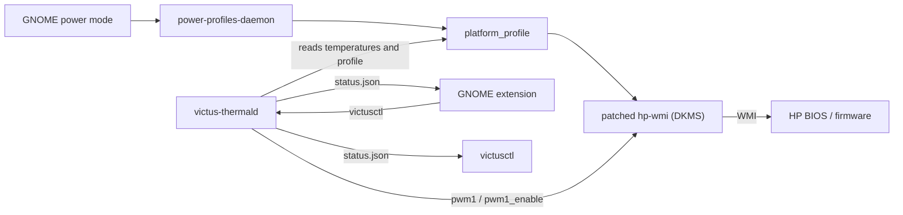

# victus-thermal

**English** | [Português](README.pt-BR.md)

**OMEN Gaming Hub-style thermal control for the HP Victus 15-fb2xxx on Linux.**

The real HP thermal modes, a fan curve per profile, emergency protection, an
indicator in the GNOME top bar and an NVIDIA GPU that only turns on when
needed, all with Secure Boot on.

| | |
|---|---|
| **Laptop** | HP Victus 15-fb2xxx, board **8C2F** (Ryzen 5 8645HS + RTX 4050) |
| **System** | Ubuntu 26.04, kernel 7.0.x, GNOME 50 (Wayland), Secure Boot on |
| **Version** | 1.9.2, see the [CHANGELOG](CHANGELOG.md) (in Portuguese) |
| **Interface language** | Brazilian Portuguese |

---

## Contents

- [Why it exists](#why-it-exists)
- [What you get](#what-you-get)
- [Installation](#installation)
- [Everyday use](#everyday-use)
- [How the fans behave](#how-the-fans-behave)
- [Configuration](#configuration)
- [Security](#security)
- [Optional extras](#optional-extras)
- [Troubleshooting](#troubleshooting)
- [Updating and uninstalling](#updating-and-uninstalling)
- [Development](#development)
- [License and credits](#license-and-credits)

---

## Why it exists

The Linux `hp-wmi` driver only turns on HP thermal control for boards on an
internal list, and **8C2F is not on it**, neither in Ubuntu nor in the
mainline kernel. Without it:

- the HP thermal modes (what OMEN controls on Windows) are never turned on.
  GNOME's "Performance" only changes the CPU settings;
- the firmware stays on its most conservative fan curve. In a load test,
  **the CPU reached 100 °C with the fans stopped for 30 s**;
- the NVIDIA driver cannot read the target temperature or the power mode
  from the BIOS (`failed to get target temp from SBIOS`).

This project fixes the root cause and adds what OMEN used to do.

## What you get

- 🌡️ **Real HP thermal modes** tied to the GNOME power mode (Power Saver,
  Balanced, Performance), including the GPU boost.
- 🌀 **A fan curve per profile**, with the HP firmware in charge under light
  load, a spike filter and a minimum on-time. No abrupt on-off cycling.
- 🔌 **Continuous quiet mode on AC power:** the fans never stop while the
  laptop is charging.
- 🚨 **Emergency:** any sensor at 95 °C or more puts the fans at full speed,
  in any mode.
- 🖥️ **GNOME top bar indicator:** temperature, RPM and controls, updated
  instantly.
- 🚀 **OMEN key = turbo:** one press switches to the Performance profile
  with the fans at full speed, and another press goes back to normal.
- 🎮 **NVIDIA only on demand:** the RTX turns off when nothing is using it,
  and games still open on it.
- 🔐 **Secure Boot on:** the driver is signed with your own key (MOK) and
  rebuilt automatically on every 7.0.x kernel update.



## Installation

> Use a **regular terminal** (Ctrl+Alt+T). `sudo` and the key creation ask
> for a password, which does not work through Claude Code's `!` prefix.

```bash
git clone git@github.com:joaocarvalhosm/victus-thermal.git ~/Projects/victus-thermal
cd ~/Projects/victus-thermal
sudo ./install.sh all
```

**First time:** `all` creates the signing key and **stops**, asking for a
password. Then:

1. Reboot (`sudo reboot`).
2. When the blue screen *"Press any key to perform MOK management"* shows up,
   **press a key within 10 seconds**.
3. **Enroll MOK** → **Continue** → **Yes** → type the password → **Reboot**.
4. Run it again: `sudo ./install.sh all`.
5. **Log out and back in** so GNOME loads the extension.

`all` tests the driver before installing it: the driver is only loaded until
the next reboot, and if anything fails the installer **goes back to the
original driver on its own**, leaving nothing installed. The steps can also
be run one at a time:

| Command | What it does |
|---|---|
| `sudo ./install.sh check` | checks the board, kernel, Python and Secure Boot |
| `sudo ./install.sh deps` | installs `dkms` and the build tools |
| `sudo ./install.sh mok` | creates the signing key and asks you to enroll it |
| `sudo ./install.sh driver-test` | loads the patched driver until the next reboot |
| `sudo ./install.sh driver-install` | installs the driver for good (DKMS) |
| `sudo ./install.sh daemon` | installs and starts the fan service |
| `sudo ./install.sh extension` | installs the GNOME extension for your user |

## Everyday use

**The GNOME power mode is the profile.** In the menu at the top right,
Power Saver, Balanced and Performance turn on the matching HP thermal mode
and fan curve.

> **For gaming:** charger plugged in + **Performance**.

### Top bar extension

The extension's interface is in Brazilian Portuguese:

```
 🌀 61°                       ← in the top bar: hottest sensor
┌──────────────────────────────────────┐
│ 🌀  61 °C                             │  orange ≥ 80 °C, red ≥ 90 °C
│     Equilibrado · Na tomada          │  (Balanced · On AC power)
├──────────────────────────────────────┤
│ CPU                          61 °C   │
│ GPU NVIDIA                Desligada  │  (Off)
│ GPU integrada                55 °C   │  (integrated GPU)
│ Ventoinhas         2400 · 2600 RPM   │  (Fans)
│ Curva: 31% a 61 °C                   │  (Curve: 31% at 61 °C)
├──────────────────────────────────────┤
│ ⚡ Modo de energia     Equilibrado ›  │  submenus, as in the GNOME menu
│ 🌀 Ventoinhas           Automático ›  │
│ Silencioso na tomada           [on]  │  (quiet on AC power)
└──────────────────────────────────────┘
```

If the service is stopped, the menu shows **Iniciar serviço** ("Start
service"), which asks for your password in the GNOME dialog.

### Keyboard light

> **Not available on the Victus 15-fb2xxx (8C2F).** On this model, the white
> keyboard light only responds to the Fn shortcut: the BIOS reports that the
> light cannot be controlled by the system, so the button below does not
> show up. Support is kept for models whose BIOS reports otherwise.

When the light can be controlled, a **Luz do teclado** ("Keyboard light")
button shows up in the GNOME **quick settings** (top right):

- **on:** the light turns off after the chosen time without keyboard or
  mouse input (arrow next to it: 30 s, 1 min, 2 min or 5 min) and turns back
  on as soon as you come back;
- **off:** the light stays as you left it.

It also turns off by itself when the screen turns off, when you close the
lid and when the laptop suspends (that part is GNOME's own behaviour). If you
turn the light off with the Fn shortcut, it is never turned back on
automatically.

### Fan modes

| Fan mode | When to use it |
|---|---|
| **Automático** (Automatic, recommended) | always. HP firmware under light load, the curve when it gets hot |
| **Somente firmware HP** (HP firmware only) | to compare with the factory behaviour |
| **Máximo** (Maximum) | to cool down fast. Only in the **Performance** profile |

A forced mode goes back to Automatic on reboot.

### OMEN key: turbo

The **OMEN** key on the keyboard, which opened the OMEN Gaming Hub on
Windows, turns **turbo** on and off:

| Press | What happens |
|---|---|
| 1st | **Performance** profile (more power for the CPU and the RTX) and fans at **Maximum** |
| 2nd | Back to **Balanced** with the fans on **Automatic** |

- **Notice:** "Turbo ligado" or "Turbo desligado" ("Turbo on" / "Turbo
  off") shows up at the top centre of the screen, where GNOME shows
  notifications, and disappears after 2.5 s.
- **Top bar fan:** when turbo turns on, the fan icon spins for 8 s, starting
  slowly and speeding up, and stops at its original position. While turbo is
  on, it uses the theme's accent colour. If turbo turns off mid-spin, it
  slows down smoothly.
- **When the notices show up:** 0.3 s after the switch, once GNOME has added
  or removed its own Performance icon in the top bar.
- **In sync:** the GNOME power menu and the extension show the switch right
  away. Changing the profile any other way also ends Maximum, as always.
- **Usage:** turbo is meant for **AC power**. Maximum is loud, and
  Performance drains the battery fast.
- **Games:** they already open on the RTX through the
  [NVIDIA only on demand](#nvidia-only-on-demand) extra.

To use another key:
`gsettings --schemadir ~/.local/share/gnome-shell/extensions/victus-thermal@joaocarvalhosm.github.io/schemas set org.gnome.shell.extensions.victus-thermal turbo-shortcut "['<Super>t']"`.
The default is `['Launch2']`, which is the OMEN key.

### Terminal

```bash
victusctl status                 # temperatures, RPM, current decision
victusctl profile performance    # low-power | balanced | performance
victusctl mode max               # curve | auto | max
victusctl ac-quiet off           # continuous quiet mode on AC power: on | off
victusctl turbo toggle           # same as the OMEN key: on | off | toggle
```

## How the fans behave

| Situation | What happens |
|---|---|
| **Booting** (first 90 s of the service) | HP firmware in charge, as before login |
| Cool, **on battery** | HP firmware in charge; the fans may stop (silence) |
| Cool, **on AC power** | continuous minimum speed (*continuous quiet mode on AC power*) |
| Quick temperature spike | ignored: the temperature is smoothed (~7 s) |
| Sustained heat (≥ 6 s) | the profile's curve takes over, **never slower** than the firmware was |
| Cooled down | keeps a low speed for 90 s, then hands back to the firmware |
| Any sensor ≥ 95 °C | **maximum**, in any mode, until everything is back to ≤ 85 °C |

The two fans (CPU and GPU) have different sizes and top speeds, so it is
normal for them to show different RPMs.

Default curves (`[temperature °C, fan %]`; 0 % = the firmware decides,
100 % = maximum):

| Profile | Curve |
|---|---|
| Power Saver | 58→0 · 60→20 · 70→30 · 80→55 · 90→80 · 95→100 |
| Balanced | 52→0 · 55→25 · 65→35 · 75→55 · 85→80 · 90→100 |
| Performance | 50→0 · 52→35 · 60→45 · 70→65 · 80→85 · 85→100 |

## Configuration

File: `/etc/victus-thermal/config.toml` (edit it with `sudo`). Changes take
effect within 2 s. An invalid file is **rejected as a whole**: the reason
goes to `journalctl -u victus-thermal`, and the default values stay in
effect.

| Option | Default | What it does |
|---|---|---|
| `poll_interval` | `2.0` | seconds between decisions |
| `emergency_temp` / `emergency_release` | `95` / `85` | turns the emergency on and off |
| `hysteresis` | `4.0` | °C the temperature must drop before the fans slow down |
| `smoothing` | `0.25` | temperature smoothing (1 = no smoothing) |
| `engage_delay` | `6.0` | seconds of continuous heat before the curve takes over |
| `hold_time` | `90.0` | seconds at low speed before handing back to the firmware |
| `startup_grace` | `90.0` | seconds with the HP firmware in charge after the service starts (boot) |
| `ac_quiet` / `ac_quiet_duty` | `true` / `15` | continuous quiet mode on AC power and its speed |
| `max_profiles` | `["performance"]` | profiles where Maximum mode is allowed |
| `[curves]` | above | one curve per profile, or `"firmware"` to leave that profile to HP alone |

The installer only updates `config.toml` if you have not edited it.

## Security

- **Emergency with no exceptions:** 95 °C or more on any sensor puts the fans
  at full speed, overriding any mode, profile or setting.
- **When in doubt, the firmware is in charge:** if the CPU sensor cannot be
  read, or the service is stopped, stuck or killed, the fans go back to the
  HP firmware. The service does this itself when it exits; `ExecStopPost`
  covers `SIGKILL` and out-of-memory kills; the 30 s systemd watchdog kills
  a stuck service.
- **No direct access to the controller:** the patch only uses WMI methods
  that the BIOS itself implements and validates (`HP_EC_OFFSET_UNKNOWN`).
- **Kernel outside the 7.0 series:** DKMS does not build the driver, and
  Ubuntu's original driver keeps working.
- **Least privilege:** the service runs as root with no *capabilities*,
  inside a systemd sandbox. `victusctl` and the extension run as a regular
  user. Mode requests and the AC power preference can only be written by the
  `victus-thermal` group and by the user who installed it; they are read
  without following symbolic links and only accepted if they are a known
  word.
- **Lightweight:** each RPM reading costs ~310 ms of BIOS time, so it is done
  every 10 s. The service uses ~1% CPU and never keeps the NVIDIA GPU awake.

Technical details: [docs/HOW-IT-WORKS.md](docs/HOW-IT-WORKS.md).

## Optional extras

### NVIDIA only on demand

Any Vulkan app, including GTK4 apps such as the terminal, loads the NVIDIA
driver when it opens, which keeps the RTX on (~2 W) even when it is not in
use.

```bash
extras/gpu-on-demand/install.sh              # no sudo; takes effect on next login
extras/gpu-on-demand/install.sh --uninstall  # undoes it
```

- Regular apps use the integrated AMD GPU, so the NVIDIA GPU can turn off.
- Steam, Lutris, Heroic, Bottles and TLauncher open **on the NVIDIA GPU**
  automatically, and games inherit that.
- Any other app: right-click its icon → *Launch using Discrete Graphics
  Card*.
- To check: `nvtop`, or
  `cat /sys/bus/pci/devices/0000:01:00.0/power/runtime_status`
  (`suspended` = off).

### Kernel failover

Uses the **newest generic kernel** (Ubuntu's default, which gets more
updates) and, if a boot fails, **automatically boots the OEM kernel** the
next time:

```bash
sudo apt install linux-generic-hwe-26.04 linux-oem-26.04   # keeps both up to date
sudo extras/kernel-failover/install.sh                     # installs
sudo extras/kernel-failover/install.sh --uninstall         # undoes it
extras/kernel-failover/install.sh --status                 # what booted, and why
```

- How it works: GRUB sets `recordfail` when it starts the kernel, and Ubuntu
  clears the flag when the boot finishes (`grub2-common.service`). If the
  flag is still there, the previous boot failed (panic, freeze or power-off
  before login). GRUB then shows the menu for 10 s and picks the OEM kernel.
- A good boot on the OEM kernel clears the flag, and the next boot goes back
  to the generic one.
- The versions are read on every `update-grub`, which runs on every kernel
  update. Nothing needs to change when a new kernel comes out.
- The fan driver (DKMS) and the NVIDIA modules are installed for both
  kernels.
- A freeze **after** login does not switch the kernel. That is the right
  behaviour, because the kernel booted fine.
- **Initrd for every kernel:** `update-initramfs` only rebuilds the initrd of
  the "newest" kernel by version number, and `7.0.0-1015-oem` sorts above
  `7.0.0-38-generic`. Without a fix, every systemd, udev or firmware update
  left the generic kernel's initrd out of date. The installer writes
  `update_initramfs=all` to `/etc/initramfs-tools/update-initramfs.conf`
  (read by Ubuntu 26.04's dracut) and rebuilds all of them right away.
- **What GRUB decided:** on every boot, GRUB writes the kernel it planned to
  boot to `grubenv` (`victus_planned`). `--status` compares it with the
  kernel that actually booted:

  | Result | Meaning |
  |---|---|
  | `ok` | the default (generic) kernel booted |
  | `failover` | the previous boot did not finish, and GRUB used the OEM kernel |
  | `GRUB planned another kernel` | the kernel was picked in the menu, or GRUB could not load the default one and used the fallback |

### Freeze diagnostics

If the warning `WARNING: kernel/workqueue.c:2351` shows up in the log, the
watcher below turns on tracing at every boot. The moment the warning
happens, it writes the responsible function (and driver) to disk, before a
possible freeze:

```bash
sudo tools/workqueue-watch.sh install     # turns it on now and at every boot
sudo tools/workqueue-watch.sh report      # shows what was captured
sudo tools/workqueue-watch.sh uninstall   # turns it off
```

The captures go to `/var/log/victus-workqueue/`.
`tools/catch-workqueue-warning.sh` does the same manually, only until the
next reboot. Before using it, see
[Full freezes when downloading or saving files](#full-freezes).

### Realtek 8852BE Wi-Fi

If you see
`rtw89 ... timed out to flush queues`:

```bash
sudo cp extras/wifi-rtw89/rtw89-stability.conf /etc/modprobe.d/ && sudo reboot
```

## Troubleshooting

<a id="full-freezes"></a>
<details open>
<summary><b>Full freezes when downloading or saving files (Ubuntu 26.04)</b></summary>

**Symptom:** the laptop freezes completely (screen, keyboard, SSH, SysRq)
and the log just stops. It happens when downloading or saving files in
**snap** apps such as Brave, Firefox and Discord, often right after the
folder chooser opens or after you answer a permission prompt ("Allow …
to access …?"). A `WARNING: kernel/workqueue.c:2351` may show up first,
each time with a different function.

**Cause:** a bug in kernel 6.17+ / 7.0 in snap **AppArmor permission
prompting**, which is on by default in Ubuntu 26.04. It is not the hardware,
the NVIDIA driver, Wi-Fi, the SSD, the RAM or this project. On this laptop,
changing the kernel, the NVIDIA driver and the Wi-Fi and SSD settings did
not fix it. A 15-minute test writing ~8 GB to the SSD did not freeze. The
freeze came ~1 s after answering a permission prompt.
Reports: [Launchpad #2143937](https://bugs.launchpad.net/apparmor/+bug/2143937),
[#2158994](https://bugs.launchpad.net/ubuntu/+source/linux/+bug/2158994),
[Ubuntu Discourse](https://discourse.ubuntu.com/t/screen-freezes-or-kernel-panics-after-enabling-permission-prompting-on-26-04/82666).

**Fix:** save your open work and turn off permission prompting in
**Security Center → App Permissions**, or in the terminal:

```bash
sudo snap set system experimental.apparmor-prompting=false
```

Then **reboot**. Turning the feature off restarts snapd, which may freeze
one last time. Snaps stay confined by AppArmor; you just stop getting the
access prompts. To check, the log should show
`the prompting feature is not enabled` from `prompting-client`. Turn it back
on once a kernel with the fix is out.
</details>

<details>
<summary><b>The blue MOK screen went by / the key was not enrolled</b></summary>

It only waits 10 seconds. Run `sudo ./install.sh mok` again, reboot and press
a key as soon as it shows up. Pick **Enroll MOK**, not *Continue boot*. To
check: `sudo ./install.sh check`.
</details>

<details>
<summary><b>The extension does not show up, or shows "Serviço parado" ("Service stopped")</b></summary>

- After installing or updating, **log out and back in**.
- Check the service: `systemctl status victus-thermal` and
  `journalctl -u victus-thermal -n 30`.
</details>

<details>
<summary><b>"Sem permissão para mudar as ventoinhas" ("No permission to change the fans")</b></summary>

Run `sudo ./install.sh daemon` again from your own user. It grants the
permission right away, with no need to log out.
</details>

<details>
<summary><b>The "Luz do teclado" (keyboard light) button does not show up</b></summary>

It only shows up when the driver exposes the light. Check with
`ls /sys/class/leds/` (there should be a `hp::kbd_backlight`) and
`journalctl -k | grep "keyboard backlight"`. After installing the driver,
log out and back in.
</details>

<details>
<summary><b>The driver did not load after a kernel update</b></summary>

The driver is only built for kernel 7.0.x. On another series, Ubuntu's
original driver keeps working, and the fans stay with the HP firmware. See
`dkms status` and `sudo ./install.sh check`.
</details>

<details>
<summary><b>I want the factory behaviour back quickly</b></summary>

`victusctl mode auto` (HP firmware only), or
`sudo systemctl stop victus-thermal`.
</details>

## Updating and uninstalling

```bash
cd ~/Projects/victus-thermal
git pull && sudo ./install.sh all     # update; then log out and back in

sudo ./uninstall.sh                   # removes the service, driver and extension; keeps the config
sudo ./uninstall.sh --purge           # removes everything, including config and preferences
```

## Development

```bash
python3 -I -m unittest discover -s tests -t .   # 110 tests, including a fake sysfs
make -C driver                                  # builds the module without installing it
```

```
victus-thermal/
├── driver/            Ubuntu's hp-wmi.c + the 8C2F entry, DKMS and the patch for the mainline kernel
├── victus_thermal/    service (Python, standard library only)
│   ├── policy.py      decisions: emergency, modes, curve, AC power, timings
│   ├── hw.py          sysfs, sensors, cached RPM, NVIDIA without waking it
│   ├── daemon.py      loop, watchdog, status, user requests
│   ├── config.py      reading and validating config.toml
│   ├── curve.py       curve, hysteresis, smoothing
│   └── cli.py         victusctl
├── gnome-extension/   top bar indicator (thermalIndicator.js) and keyboard light (keyboardLight.js)
├── packaging/         systemd unit, tmpfiles, default config
├── extras/            NVIDIA on demand, rtw89 Wi-Fi
├── tools/             freeze diagnostics
├── tests/             unit and integration tests
└── docs/              how it works, sending the patch upstream
```

The 8C2F patch for the mainline kernel is in `driver/patches/`. The steps to
send it are in [docs/UPSTREAM.md](docs/UPSTREAM.md).

## License and credits

- Service, extension and tools: **GPL-3.0-or-later**.
- `driver/hp-wmi.c`: the kernel's original license, **GPL-2.0-or-later**.
- The `victus_s` family for 8C2F was independently confirmed by
  [omen-fan-control](https://github.com/arfelious/omen-fan-control) v2.1.0.
- Inspired by [victus-control](https://github.com/Batuhan4/victus-control).
